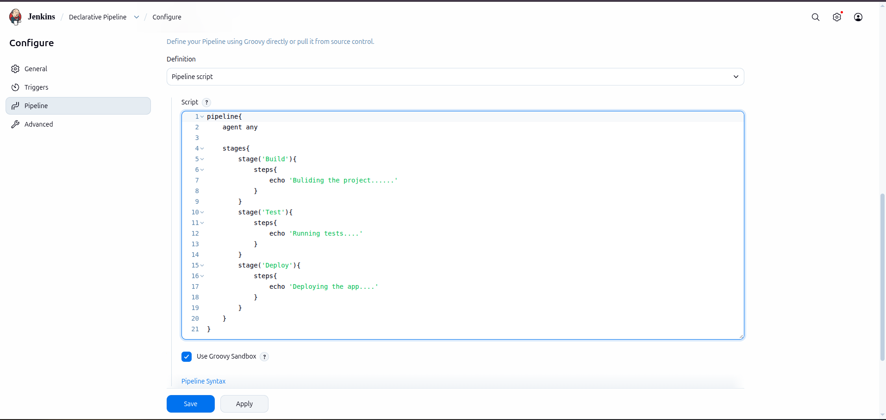
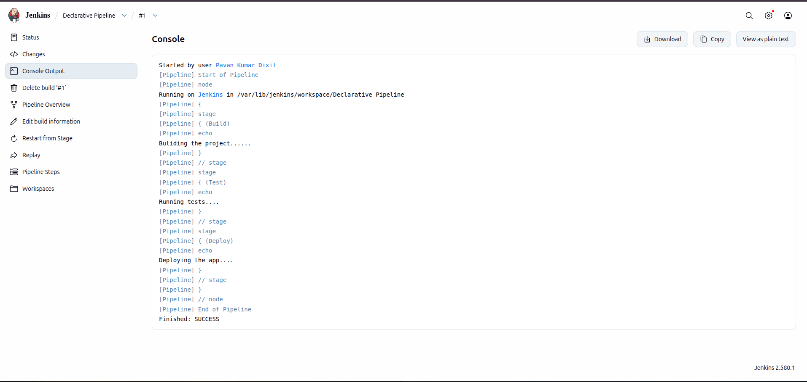

# Jenkins Declarative Pipeline

## Overview

Declarative Pipeline is one of the two major types of Jenkins Pipeline. It provides a structured, readable, and simplified way to define CI/CD workflows.

It uses a predefined syntax with specific blocks such as `pipeline`, `agent`, `stages`, `stage`, and `steps`.

Declarative Pipeline is designed to make pipeline configuration easier to understand, maintain, and manage.

It is generally recommended for beginners and standard CI/CD automation projects.

## What is Declarative Pipeline?

Declarative Pipeline is a structured approach to defining Jenkins automation workflows.

It follows a predefined syntax and requires the pipeline configuration to be written inside a `pipeline` block.

A Declarative Pipeline is generally stored in a file named `Jenkinsfile` in the root directory of a Git repository.

## Basic Syntax

```groovy
pipeline {

    agent any

    stages {

        stage('Build') {
            steps {
                echo 'Building Application'
            }
        }

        stage('Test') {
            steps {
                echo 'Testing Application'
            }
        }

        stage('Deploy') {
            steps {
                echo 'Deploying Application'
            }
        }

    }
}
```

## Understanding Declarative Pipeline Components

### 1. pipeline

The `pipeline` block is the main structure of a Declarative Pipeline.

All pipeline configurations are defined inside this block.

### 2. agent

The `agent` directive specifies where Jenkins should execute the pipeline.

Common options:

- `agent any` – Runs the pipeline on any available agent.
- `agent none` – No global agent is allocated; individual stages can define their own agents.
- `agent { label 'linux' }` – Runs on an agent with the specified label.

### 3. stages

The `stages` block contains all the stages of the pipeline.

It organizes the complete CI/CD process into separate sections.

### 4. stage

The `stage` block represents an individual phase of the pipeline.

Examples:

- Build
- Test
- Package
- Deploy

### 5. steps

The `steps` block contains the actual instructions Jenkins executes within a stage.

Examples:

- `echo`
- `sh`
- `git`
- `bat`

### 6. post

The `post` block defines actions that Jenkins executes after the pipeline or stage completes.

Common post conditions:

- `always` – Executes regardless of the pipeline result.
- `success` – Executes when the pipeline succeeds.
- `failure` – Executes when the pipeline fails.
- `unstable` – Executes when the pipeline becomes unstable.
- `cleanup` – Executes after other post conditions.

### 7. environment

The `environment` directive defines environment variables that can be used throughout the pipeline or within a specific stage.

### 8. parameters

The `parameters` directive allows users to provide input values when starting a pipeline build.

### 9. when

The `when` directive controls whether a particular stage should execute based on specified conditions.

## How Declarative Pipeline Works

1. Jenkins reads the `Jenkinsfile` from the repository or pipeline configuration.
2. Jenkins identifies the `pipeline` block.
3. Jenkins allocates an agent according to the configured `agent` directive.
4. Jenkins executes the stages in the defined order.
5. Each stage executes its instructions through the `steps` block.
6. Jenkins processes the configured post-build actions.
7. Jenkins displays the final pipeline execution status.

## Declarative Pipeline Code

The following image shows the Declarative Pipeline implementation used in this project.



## Declarative Pipeline Output

The following image shows the pipeline execution output in Jenkins.



## Advantages of Declarative Pipeline

- Easy to learn and understand.
- Follows a structured syntax.
- Beginner-friendly.
- Easy to maintain and debug.
- Supports built-in directives.
- Provides structured error handling through `post` conditions.
- Supports environment variables and parameters.
- Suitable for standard CI/CD workflows.

## Disadvantages of Declarative Pipeline

- Less flexible than Scripted Pipeline for complex programming logic.
- Requires following predefined syntax rules.
- Advanced dynamic logic can be more difficult to implement.
- Complex custom workflows may require Scripted Pipeline features.

## When to Use Declarative Pipeline?

Declarative Pipeline is useful when:

- You are starting with Jenkins Pipeline.
- You need a structured CI/CD workflow.
- You want readable and maintainable pipeline code.
- You need standard build, test, and deployment automation.
- You want to manage pipeline execution using predefined directives.

## Declarative vs Scripted

Declarative Pipeline focuses on structured syntax and simplicity, whereas Scripted Pipeline provides greater flexibility through Groovy programming.

For most standard CI/CD workflows, Declarative Pipeline is a good starting point.

## Conclusion

Declarative Pipeline is a beginner-friendly and structured approach to Jenkins automation.

Its predefined syntax makes it easier to create, understand, and maintain CI/CD workflows.

Learning Declarative Pipeline is an important step toward building professional Jenkins automation and implementing real-world DevOps practices.

---

**Author:** Pavan Kumar Dixit

**Technology:** Jenkins | Groovy | CI/CD
