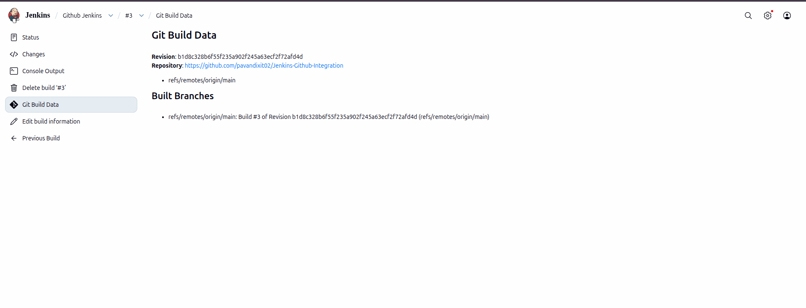
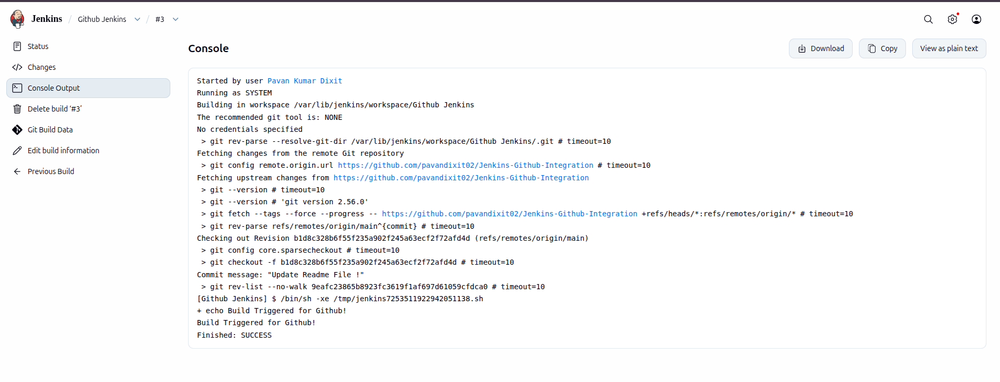
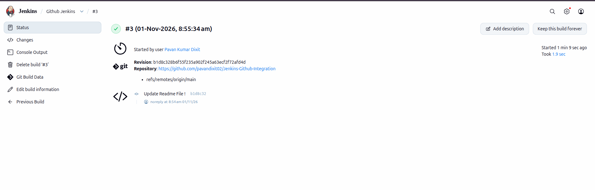

# Jenkins-GitHub Integration

## Project Overview

This project demonstrates the integration of **Jenkins with GitHub** to automate the Continuous Integration (CI) process.

The primary objective is to establish a seamless connection between GitHub and Jenkins using GitHub Webhooks. Whenever developers push new code changes to the GitHub repository, Jenkins automatically receives a notification and triggers the configured job.

This integration helps automate development workflows, reduce manual intervention, and improve software delivery efficiency.

## Objectives

- Integrate Jenkins with GitHub.
- Establish communication between Jenkins and GitHub repositories.
- Configure automated build triggers using GitHub Webhooks.
- Monitor source code changes and trigger Jenkins jobs automatically.
- Understand the practical implementation of Continuous Integration.
- Automate Jenkins job execution whenever new code is pushed.

## Technologies Used

| Technology | Purpose |
|---|---|
| Jenkins | CI/CD automation server |
| GitHub | Source code management |
| Git | Distributed version control |
| Ubuntu Linux | Operating system |
| GitHub Webhooks | Automated event notifications |
| Jenkins Jobs | Automated build execution |

## Project Workflow

1. Source code is maintained in a GitHub repository.
2. Jenkins is configured to connect with the GitHub repository.
3. GitHub Webhooks are configured to communicate with Jenkins.
4. A developer pushes new code changes to GitHub.
5. GitHub sends a webhook notification to Jenkins.
6. Jenkins automatically triggers the configured job.
7. Jenkins fetches the latest source code.
8. The configured build process is executed.
9. Build results are monitored through the Jenkins dashboard.

## GitHub Webhook Integration

GitHub Webhooks allow GitHub to send real-time event notifications to Jenkins whenever specific repository activities occur.

In this project, a webhook is configured to trigger Jenkins automatically when new code changes are pushed to the GitHub repository.

### 1. GitHub Repository Integration

This screenshot demonstrates the integration between the GitHub repository and Jenkins, including the repository configuration and Git-related information.

### 2. Jenkins Build Execution

This screenshot demonstrates the Jenkins job execution after receiving a notification from GitHub.

### 3. Integration Status

This screenshot represents the integration status and successful execution workflow between GitHub and Jenkins.

## Key Learnings

- Jenkins installation and configuration.
- GitHub repository integration.
- Source code management using Git.
- GitHub Webhook configuration.
- Automated Jenkins job triggering.
- Understanding webhook event notifications.
- Monitoring Jenkins build execution.
- Practical implementation of Continuous Integration.

## Project Outcome

Successfully established a Jenkins and GitHub integration workflow using GitHub Webhooks.

Whenever new code changes are pushed to the configured GitHub repository, Jenkins receives the webhook notification and automatically triggers the configured job.

This project demonstrates practical knowledge of source code integration, automation, and Continuous Integration concepts.

## Future Enhancements

- Implement automated testing.
- Build and package applications using Jenkins.
- Integrate Docker for containerization.
- Automate application deployment.
- Integrate cloud platforms such as AWS.
- Implement complete CI/CD automation.

## Conclusion

This project demonstrates an essential DevOps practice by integrating Jenkins with GitHub using Webhooks.

It provides hands-on experience with repository integration, automated build triggering, webhook configuration, and Continuous Integration.

These concepts establish a strong foundation for building real-world DevOps automation workflows.

---

**Author:** Pavan Kumar Dixit

**Project:** Jenkins-GitHub Integration

**Technologies:** Jenkins | GitHub | Git | Ubuntu | Webhooks