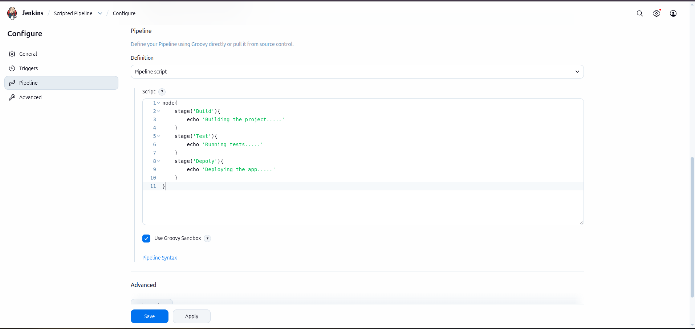
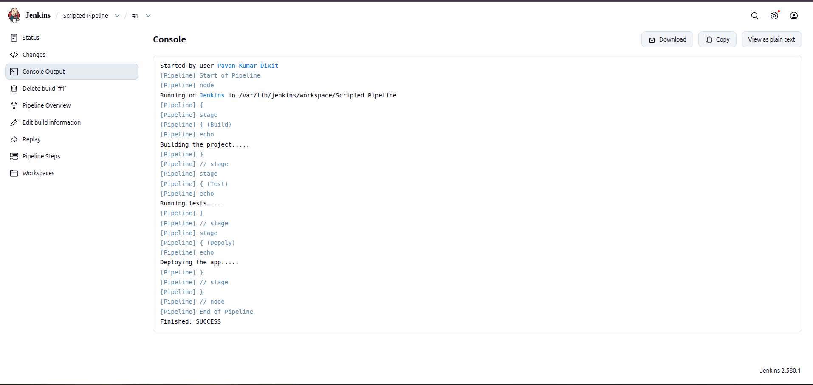

# Jenkins Scripted Pipeline

## Overview

Scripted Pipeline is one of the two major types of Jenkins Pipeline. It is based on the Groovy programming language and provides a flexible way to automate CI/CD workflows.

Unlike Declarative Pipeline, Scripted Pipeline does not enforce a strict predefined structure. Developers can write pipeline logic using Groovy programming concepts such as variables, conditional statements, loops, functions, and exception handling.

Scripted Pipeline is particularly useful when a project requires complex automation logic and greater control over pipeline execution.

## What is Scripted Pipeline?

Scripted Pipeline is a programmatic approach to defining Jenkins CI/CD workflows.

It allows developers to write pipeline instructions inside a `node` block, where Jenkins executes the defined stages and steps on an available agent.

A Scripted Pipeline is generally written inside a `Jenkinsfile`.

## Basic Syntax

```groovy
node {

    stage('Build') {
        echo 'Building Application'
    }

    stage('Test') {
        echo 'Testing Application'
    }

    stage('Deploy') {
        echo 'Deploying Application'
    }

}
```

## Understanding Scripted Pipeline Components

### 1. node

The `node` block tells Jenkins to allocate an executor on an available agent and execute the pipeline instructions.

It can also specify a particular agent using a label.

### 2. stage

The `stage` block divides the pipeline into logical sections.

Examples:

- Build
- Test
- Package
- Deploy

Stages make pipeline execution easier to understand and monitor.

### 3. steps

Scripted Pipeline uses Groovy statements and Jenkins Pipeline steps directly inside its blocks.

For example:

- `echo` – Displays messages in the console.
- `sh` – Executes shell commands on Linux agents.
- `bat` – Executes commands on Windows agents.
- `git` – Checks out source code from Git repositories.

### 4. Groovy Programming

Scripted Pipeline supports programming features such as:

- Variables
- Conditional statements
- Loops
- Functions
- Exception handling
- Dynamic execution logic

These features provide greater flexibility when designing advanced automation workflows.

## How Scripted Pipeline Works

1. Jenkins reads the `Jenkinsfile` from the repository or pipeline configuration.
2. Jenkins identifies the `node` block.
3. Jenkins allocates an available agent and executor.
4. Jenkins executes the pipeline stages sequentially unless parallel execution is configured.
5. Each stage performs its defined tasks.
6. Jenkins displays execution status and console output.
7. The pipeline finishes with a success or failure status.

## Scripted Pipeline Code

The following image shows the Scripted Pipeline implementation used in this project.



## Scripted Pipeline Output

The following image shows the pipeline execution output in Jenkins.



## Advantages of Scripted Pipeline

- Provides high flexibility and programming control.
- Supports advanced Groovy logic.
- Allows dynamic pipeline execution.
- Supports loops and conditional statements.
- Suitable for complex automation workflows.
- Provides programmatic error handling.
- Allows reusable functions and methods.

## Disadvantages of Scripted Pipeline

- Requires knowledge of Groovy programming.
- Comparatively difficult for beginners.
- Less structured than Declarative Pipeline.
- Complex pipelines can become difficult to maintain.
- Requires more effort to maintain readability.

## When to Use Scripted Pipeline?

Scripted Pipeline is useful when:

- You need complex pipeline logic.
- You require dynamic stage generation.
- You need advanced conditional execution.
- You want greater control over pipeline behavior.
- Your automation workflow requires custom programming logic.

## Scripted vs Declarative

Scripted Pipeline focuses on flexibility and programmatic control, while Declarative Pipeline focuses on simplicity and predefined structure.

Scripted Pipeline is generally preferred for advanced automation requirements, whereas Declarative Pipeline is recommended for standard CI/CD workflows.

## Conclusion

Scripted Pipeline is a powerful Jenkins automation approach that provides flexibility through Groovy programming.

It is especially useful for advanced CI/CD workflows where developers need complete control over execution logic.

Understanding Scripted Pipeline helps DevOps engineers build customized automation solutions and manage complex software delivery processes.

---

**Author:** Pavan Kumar Dixit

**Technology:** Jenkins | Groovy | CI/CD

